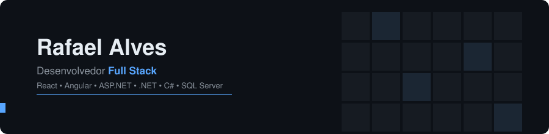

## **Khaeryn**

Atualmente, estou desenvolvendo a Khaeryn, um projeto pessoal com o objetivo de criar soluções tecnológicas modernas, escaláveis e focadas em resolver problemas reais. A iniciativa envolve o desenvolvimento de aplicações e ferramentas que unem boas práticas de arquitetura, experiência do usuário e tecnologias atuais, servindo também como um ambiente para explorar novas ideias, aprimorar conhecimentos e transformar conceitos em produtos de valor.

**[Venha conferir](https://github.com/Khaeryn-Technologies)**

##  Sobre mim

Desenvolvedor Full Stack com experiência na criação e manutenção de aplicações web, atuando tanto no front-end quanto no back-end. Trabalho com **React (TypeScript)**, **Angular (TypeScript)**, **ASP.NET com Razor**, **.NET**, **C#**, **SQL Server**, **JavaScript**, **jQuery**, **Tailwind CSS** e gerenciamento de aplicações em **IIS**.

Tenho foco em desenvolver soluções performáticas, bem estruturadas e com uma excelente experiência para o usuário, sempre buscando escrever código limpo, escalável e de fácil manutenção.

Além do desenvolvimento, sou responsável pela organização e gerenciamento dos repositórios da empresa no GitHub, apoio na definição e acompanhamento de tarefas da equipe e atuo auxiliando desenvolvedores mais novos, compartilhando conhecimento e contribuindo para o crescimento técnico do time.

 

## Stack

### **Back-end**

Tecnologias: ASP.NET (Razor), .NET, C#, SQL Server, IIS e Postman

### **Front-end**

**Tecnologias:** React, Angular, TypeScript, JavaScript, jQuery, HTML, CSS e Tailwind CSS

### **Ferramentas & Versionamento**

**Atuação:** Organização e gerenciamento de repositórios da empresa, controle de versionamento e colaboração com a equipe.

 
